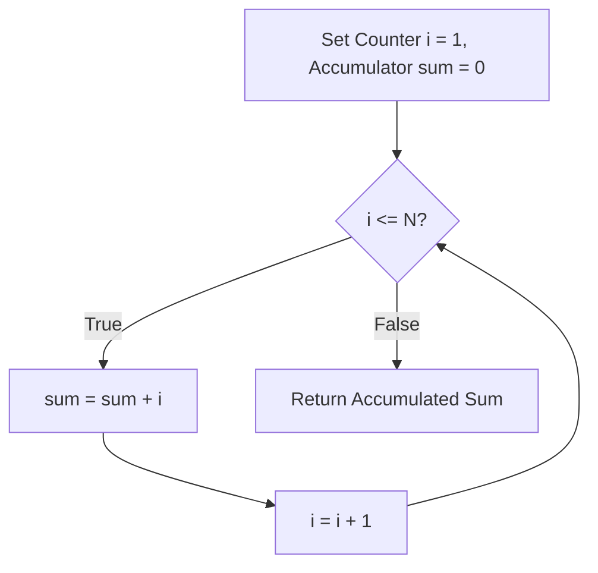

<p align="center">
  
</p>

<p align="center">
  
  
  
  
  
</p>

---

## Executive Summary / Overview
### Problem Statement & Context
Iteration is the fundamental mechanism by which computers perform repetitive tasks. Developing a mathematically sound grasp of loop invariants, step increments, and conditional termination bounds is essential for preventing non-terminating loops and ensuring predictable algorithmic performance.

### Solution Overview
This repository delivers an empirical examination of **Python Looping Statements and Sequences**. Featuring structured notebooks focused on the generation and accumulation of natural numbers, it demonstrates both `for` and `while` iterative patterns, accumulator state tracking, and asymptotic linearity.

---

## Interactive Table of Contents
- [Executive Summary / Overview](#executive-summary--overview)
- [Key Features & Capabilities](#key-features--capabilities)
- [System Architecture / Pipeline](#system-architecture--pipeline)
- [Tech Stack Breakdown](#tech-stack-breakdown)
- [Reproducible Quickstart & Setup](#reproducible-quickstart--setup)
- [Project Directory Layout](#project-directory-layout)
- [Author & Contributions](#author--contributions)

---

## Key Features & Capabilities
- **Natural Number Generation:** Algorithmic computation of first n natural numbers and sequential partial sums.
- **Loop Invariant Verification:** Clear stepwise invariants guaranteeing convergence toward the termination predicate.
- **Linear Space & Time Profiling:** Demonstrates O(n) time complexity and O(1) auxiliary space accumulation.
- **Interactive Notebook Delivery:** Step-by-step cells facilitating immediate trace evaluation.

---

## System Architecture / Pipeline


---

## Tech Stack Breakdown
| Layer | Technology | Usage |
| :--- | :--- | :--- |
| **Languages** | Python 3.10+ | Core algorithmic scripting |
| **Libraries** | Python Standard Library | Arithmetic operations and sequence iteration |
| **Tools** | Jupyter Notebook | Stepwise evaluation and trace plotting |
| **Architecture** | Procedural / Imperative | State-based iteration and accumulator mechanics |

---

## Reproducible Quickstart & Setup
```bash
# 1. Clone repository
git clone https://github.com/suryateja-155/looping-statements.git
cd looping-statements

# 2. Virtual environment setup
python -m venv venv
.\venv\Scripts\activate   # On Windows

# 3. Install Jupyter
pip install notebook

# 4. Run notebook
jupyter notebook "first n natural numbers.ipynb"
```

---

## Project Directory Layout
```text
looping-statements/
├── first n natural numbers.ipynb       # Iteration over natural number sequences
├── first n natural numbers (1).ipynb   # Extended boundary analysis notebook
└── README.md                           # Algorithmic invariants and complexity guide
```

---

## Author & Contributions

**Gettupalli Surya Teja**  
- GitHub Profile: [@suryateja-155](https://github.com/suryateja-155)  
- Portfolio Index: [Gettupalli-Surya-Teja](https://github.com/suryateja-155/Gettupalli-Surya-Teja)

Contributions, issue reports, and feedback are always welcome! Feel free to open an issue or pull request.

<p align="center">
  
</p>
